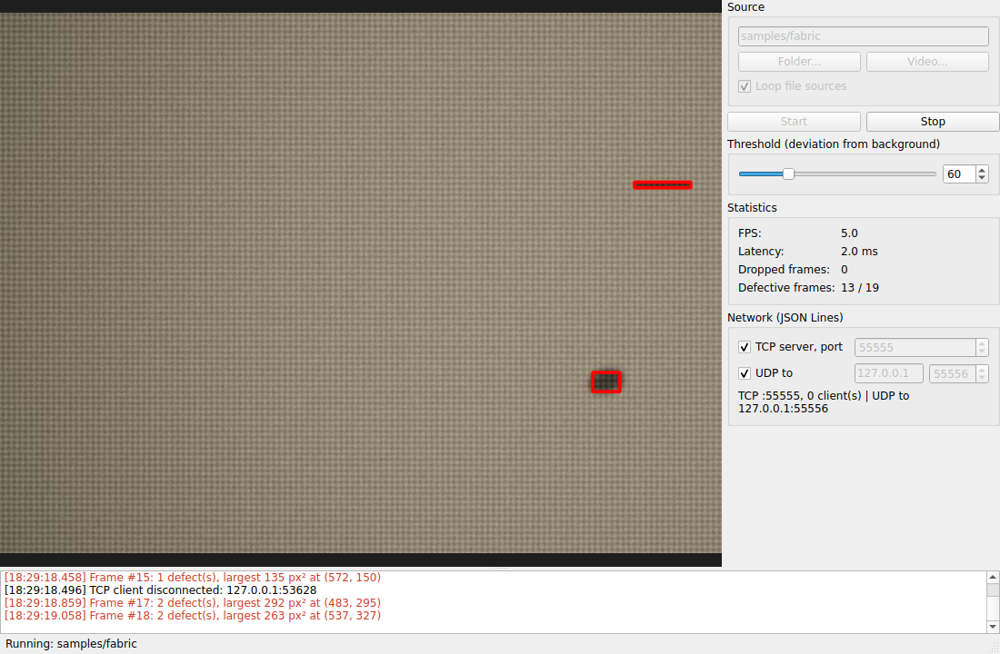
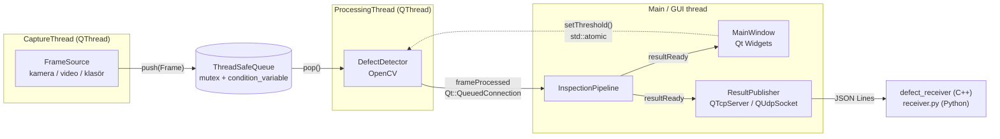

# Defect Inspector

[](https://github.com/mervanAksu/QT-Defect-Inspector/actions/workflows/ci.yml)

Qt 6 + OpenCV ile yazılmış, Linux üzerinde çalışan **kamera izleme ve kusur tespit** uygulaması (C++17).
Kameradan, video dosyasından ya da bir görüntü klasöründen kare alır; kareleri ayrı bir thread'de
işleyip kumaş yüzeyindeki leke, delik ve yırtık gibi kusurları bulur, sonucu arayüzde gösterir ve
TCP/UDP üzerinden başka istemcilere (C++ ve Python) gönderir.



*Sentetik kumaş örnekleri üzerinde canlı tespit: kusurlar kırmızı kutuyla işaretlenir. Sağda eşik
ayarı, istatistikler ve ağ yayını, altta kusurlu karelerin logu.*

## Öne çıkanlar

| Konu | Projede nerede? |
|---|---|
| **C++17, OOP** | `FrameSource` soyut sınıfı + kamera/video/klasör alt sınıfları (polimorfizm, NVI, RAII), fabrika fonksiyonu |
| **Qt Widgets, signal/slot** | `MainWindow`, özel `paintEvent`'li `ImageView`, thread'ler arası `Qt::QueuedConnection`, `QSettings` |
| **Multithreading, senkronizasyon** | İki `QThread` + `std::mutex`/`std::condition_variable` ile sınırlı producer–consumer kuyruğu, `std::atomic` eşik, temiz kapanış |
| **OpenCV** | Yerel arka plan farkıyla kusur tespiti; ~2 ms / 640×480 kare |
| **TCP/IP, UDP** | `QTcpServer` + `QUdpSocket` ile JSON Lines yayını, mesaj çerçeveleme, yavaş istemci koruması |
| **Python** | Yalnızca standart kütüphaneyle alıcı istemci (TCP/UDP, CSV kaydı, yeniden bağlanma) |
| **CMake, testler** | Modüler CMake; **109 test** (GoogleTest + Qt Test + Python unittest) |
| **Linux, debugging** | GitHub Actions CI: `-Werror` derleme, **AddressSanitizer + UBSan**, **ThreadSanitizer** |
| **Git** | Her özellik ayrı branch'te geliştirilip açıklamalı bir PR ile birleştirildi ([geliştirme süreci](#geliştirme-süreci)) |

## Hızlı başlangıç (Ubuntu 24.04 / WSL2)

```bash
git clone https://github.com/mervanAksu/QT-Defect-Inspector.git && cd QT-Defect-Inspector
bash scripts/setup_ubuntu.sh                  # Qt 6, OpenCV, GoogleTest, CMake, Ninja
cmake -S . -B build -G Ninja && cmake --build build
./build/src/app/defect_inspector --start      # örnek kumaş görüntüleriyle hemen başlar
```

Windows 11'de WSL2 kullanılıyorsa pencere WSLg sayesinde doğrudan Windows masaüstünde açılır.

## Mimari



**Neden bu yapı?**

- **Capture ↔ Processing arasında sınırlı bir kuyruk:** Görüntü işleme kameradan yavaş kalırsa
  kareler Qt olay kuyruğunda sınırsızca birikip belleği ve gecikmeyi şişirmesin diye. Kuyruk doluyken
  en eski kare atılır (drop-oldest), çünkü canlı izlemede güncellik eksiksizlikten önemlidir. Atılan kareler sayılır ve arayüzde gösterilir.
- **Processing → GUI arasında signal/slot (`Qt::QueuedConnection`):** Qt widget'larına yalnızca
  ana thread'den dokunulabilir. Queued bağlantı, sonucu ana thread'in olay döngüsüne güvenle taşır.
- **GUI → Processing yönünde `std::atomic<int>` eşik:** Tek bir tamsayı için kilit gereksiz.
  `DefectDetector` nesnesi yalnızca processing thread'inde yaşar, hiç paylaşılmaz.
- **Temiz kapanış:** `stop()` thread'lere kesme isteği gönderir, kuyruğu kapatarak `pop()`'ta
  bekleyeni uyandırır ve `wait()` ile bitmelerini bekler. Kaynak kendiliğinden biterse üretici
  kuyruğu kapatır, tüketici kalan kareleri işleyip çıkar.
- **Katmanlı kütüphaneler:** `core` Qt'ye bağımlı değildir (C++17 + OpenCV). GUI olmadan test
  edilebilir ve başka bir uygulamada (ör. Jetson üzerinde konsol servis) yeniden kullanılabilir.
  Üst katmanlar yalnızca alttakine bağımlıdır: `core` ← `pipeline` ← `net` ← `app` / `receiver`.

## Kusur tespiti

`DefectDetector` ([kaynak](src/core/src/DefectDetector.cpp)) klasik görüntü işleme kullanır:

1. Gri tonlamaya çevir.
2. Gaussian blur ile dokuyu ve sensör gürültüsünü bastır.
3. 101×101'lik bir pencerede ortalama alarak **yerel arka planı** tahmin et (box filtre, piksel başına O(1)).
4. `|görüntü − arka plan|` farkını eşikle. Böylece hem koyu leke hem açık delik yakalanır.
5. Morfolojik açma ile tek piksellik kırıntıları temizle.
6. Dış konturları bul, küçükleri ele, kalanları alana göre sıralı raporla.

**Neden sabit (global) bir eşik değil?** Gerçek bir kamerada aydınlatma görüntü boyunca eşit değildir;
global eşik karanlık köşeleri kusur sanar. Testlerde soldan sağa 80 → 220 kararan bir zeminde
yalnızca gerçek leke bulunuyor.

`samples/fabric/` içindeki 12 görüntü [`tools/generate_samples`](tools/SampleGenerator.cpp) ile
üretildi: dokuma deseni, düzensiz aydınlatma ve sensör gürültüsü üzerine leke/delik/yırtık. Üreteç
her kusurun yerini de döndürür (ground truth). Bu sayede testler dedektörün **tam olarak** yerleştirilen
kusurları bulduğunu ölçer: 12 görüntünün hepsinde doğru sayı bulunuyor ve temiz görüntülerde yanlış alarm çıkmıyor.

## Çalıştırma

```bash
./build/src/app/defect_inspector                          # kayıtlı ayarlar ya da örnek klasör
./build/src/app/defect_inspector samples/fabric --start   # hemen başlat
./build/src/app/defect_inspector video.mp4 -t 45          # video dosyası, eşik 45
./build/src/app/defect_inspector 0                        # kamera /dev/video0
./build/src/app/defect_inspector --start --tcp 5555 --udp 127.0.0.1:5556
./build/src/app/defect_inspector --help                   # tüm seçenekler
```

## Ağ üzerinden sonuç yayını (TCP / UDP)

Her işlenen kare için tek satırlık bir JSON mesajı yayınlanır (**JSON Lines**). Arayüzdeki
"Network" bölümünden ya da `--tcp` / `--udp` seçenekleriyle açılır. En basit istemci `nc localhost 5555`.

```json
{"type":"inspection","version":1,"frame":3,"sent_at":"2026-11-26T15:29:16.055Z",
 "defect_count":1,"processing_ms":1.816,"latency_ms":2.094,"dropped_frames":0,
 "image":{"width":640,"height":480},
 "defects":[{"x":556,"y":127,"width":35,"height":48,"cx":572.76,"cy":150.31,"area":135}]}
```

*(Gerçekte her mesaj tek satırdır; burada okunabilirlik için bölündü.)*

| | TCP sunucusu | UDP |
|---|---|---|
| Model | Bağlanan her istemciye gönderilir | Tek bir hedef adrese (ya da broadcast) |
| Garanti | Güvenilir, sıralı | Kayıp olabilir, sıra garanti değil |
| Çerçeveleme | `\n` ile (TCP bir bayt akışıdır, mesaj sınırı yoktur) | Her datagram = bir mesaj |
| Ne zaman? | Kayıt/raporlama, her sonuç önemli | Canlı gösterge, en güncel değer önemli |

- **Çerçeveleme:** Bir `read()` yarım mesaj ya da birden fazla mesaj getirebilir. `LineBuffer`
  parçaları biriktirip yalnızca tamamlanmış satırları verir. 64 KiB'tan uzun satırları atar (bellek koruması).
- **Yavaş istemci:** Okumayan bir istemcinin bekleyen verisi 1 MiB'ı aşarsa ona giden mesajlar atlanır.
- **Doğrudan bağlantı:** Soketler `QNetworkProxy::NoProxy` kullanır; yerel ağ bağlantısı masaüstünün
  HTTP proxy ayarlarından etkilenmez.
- **Sürümleme:** Mesajlarda `version` alanı var. Alıcılar bilmedikleri sürümü reddeder.
- **Thread:** Qt soketleri asenkrondur (`write()` bloklamaz), bu yüzden yayıncı GUI thread'inde çalışır.

### Alıcı istemciler

Aynı çıktıyı üreten iki istemci var: biri C++/Qt (`QCoreApplication`, GUI yok), diğeri yalnızca standart
kütüphaneyi kullanan Python (`pip install` gerekmez; ör. hat yanındaki bir Raspberry Pi'de çalışabilir).

```bash
./build/src/receiver/defect_receiver --port 5555 --only-defects
python3 python/receiver.py --port 5555 --csv defects.csv
python3 python/receiver.py --udp 5556
```

```text
connecting to 127.0.0.1:5555
error: Connection refused
reconnecting in 1 s
error: Connection refused
reconnecting in 2 s
connected
#8      2 defect(s)  largest 107 px² @ (50,68)  latency 2.0 ms
#9      3 defect(s)  largest 567 px² @ (313,155)  latency 1.6 ms
#10     OK  latency 1.9 ms
```

- **Otomatik yeniden bağlanma:** Bekleme süresi her denemede ikiye katlanır (1 → 2 → 4 … en fazla
  30 s), başarılı bağlantıda başa döner. Sabit aralıkla deneyen yüzlerce istemci, yeniden açılan
  sunucuyu aynı anda boğabilir ("thundering herd").
- **Hatalı mesaj bağlantıyı kesmez:** Çözülemeyen satırlar sayılır ve raporlanır, akış devam eder.
- **Ctrl+C:** İki istemci de düzgün çıkar ve özet basar. C++'ta sinyal işleyicisi yalnızca bir
  `sig_atomic_t` bayrağı kaldırır (async-signal-safe), çıkışı olay döngüsü yapar.

## Sağlamlık

Üretim hattında uygulamanın operatör müdahalesi olmadan çalışmaya devam etmesi gerekir:

- **Kopan kamera:** Canlı bir kaynak kare vermeyi keserse (kablo çıktı, kamera yeniden başladı) akış
  durmaz. Capture thread'i kaynağı üstel geri çekilmeyle (250 ms → … → 4 s) yeniden açmayı dener;
  log'da turuncu "Source lost" ve yeşil "Source recovered after N attempt(s)" görünür. Bekleme
  20 ms'lik dilimlere bölündüğü için Stop'a basıldığında hemen durur.
- **Bozuk görüntü dosyası:** Okunamayan bir dosya atlanır ve sayılır, akış devam eder. Klasördeki
  dosyaların hepsi bozuksa sonsuz döngüye girmeden biter.
- **Video dosyası:** Eksik dosya anında net bir hatayla reddedilir ve yalnızca FFmpeg arka ucu
  kullanılır. Önceden OpenCV tüm arka uçları sırayla deniyordu; bu yavaştı ve bellek sızdırıyordu (ASan buldu).
- **Ayarların kaydı (`QSettings`):** Kaynak, eşik, TCP/UDP ayarları, pencere boyutu ve ayraç
  konumu kapanışta kaydedilir (`~/.config/DefectInspector/Defect Inspector.conf`) ve açılışta geri
  yüklenir. Öncelik: komut satırı > kayıtlı ayar > varsayılan.
- **Test edilebilirlik:** `InspectionPipeline::start(std::unique_ptr<FrameSource>)` hazır bir kaynak
  kabul eder (bağımlılık enjeksiyonu). Testler bununla gerçek kamera olmadan "5 kare sonra kopan,
  3. denemede geri gelen" sahte bir kamerayı enjekte eder.

## Testler

```bash
ctest --test-dir build --output-on-failure     # 55 ctest girdisi, 109 test durumu
```

| Program | Çatı | Durum | Neyi test eder? |
|---|---|---|---|
| `core_tests` | GoogleTest | 50 | Kuyruk (çok üretici/tüketici dahil), dedektör, 12 gerçekçi örnek görüntü, kaynaklar, FPS ölçer |
| `pipeline_tests` | Qt Test | 9 | Gerçek thread'lerle uçtan uca akış, durdurma/yeniden başlatma, çalışırken eşik değişimi, kopan kamera |
| `net_tests` | Qt Test | 19 | Protokol, bozuk mesajlar, bayt bayt çerçeveleme, localhost TCP/UDP soketleri |
| `receiver_tests` | Qt Test | 7 | Gerçek yayıncıya bağlanma, sunucu yeniden açılınca bağlanma, geri çekilme süreleri |
| `ui_tests` | Qt Test | 10 | Pencere kullanıcı gibi kullanılır (`QTest::mouseClick`), ağ yayını, kayıtlı ayarlar |
| `python_receiver_tests` | unittest | 14 | Python istemcisi: doğrulama, çerçeveleme, CSV, TCP yeniden bağlanma, UDP |

GUI testleri ekran gerektirmez; ctest onları `QT_QPA_PLATFORM=offscreen` ile çalıştırır.

## Sürekli entegrasyon ve sanitizer'lar

[`.github/workflows/ci.yml`](.github/workflows/ci.yml) her push (main) ve pull request'te, geliştirme
ortamıyla aynı dağıtımda (Ubuntu 24.04) üç iş çalıştırır:

| İş | Ne yapar? |
|---|---|
| **Build & test** | Release derleme, tüm uyarılar hata (`-Werror`), tüm testler (C++ + Python) |
| **AddressSanitizer + UBSan** | Tüm testler bellek hatası, sızıntı ve tanımsız davranış için (`-fno-sanitize-recover=all`) |
| **ThreadSanitizer** | `core_tests`: kuyruk ve thread'li kod data race için |

Yerelde aynısı:

```bash
# AddressSanitizer + UndefinedBehaviorSanitizer (tüm testler)
cmake -S . -B build-asan -G Ninja -DINSPECTOR_SANITIZER=address,undefined \
      -DCMAKE_CXX_FLAGS=-fno-sanitize-recover=all
cmake --build build-asan
LSAN_OPTIONS="suppressions=$PWD/lsan.supp" ctest --test-dir build-asan --output-on-failure

# ThreadSanitizer (çekirdek testler)
cmake -S . -B build-tsan -G Ninja -DINSPECTOR_SANITIZER=thread
setarch -R cmake --build build-tsan
TSAN_OPTIONS="suppressions=$PWD/tsan.supp" setarch -R ./build-tsan/tests/core_tests
```

Notlar:

- **`setarch -R`:** Yeni Linux çekirdeklerinde (WSL2 dahil) adres rastgeleleştirmesi (ASLR) GCC 13'ün
  TSan'ı ile uyumsuzdur ve program `unexpected memory mapping` hatasıyla açılmaz. `setarch -R` ASLR'yi yalnızca o
  komut için kapatır; root gerekmez.
- **Suppression dosyaları yalnızca üçüncü parti kütüphaneleri içerir:** `tsan.supp` TBB ve GDAL'ı,
  `lsan.supp` ise libproxy'nin tek seferlik ayırmasını kapsar. Kendi kodumuzdaki bir bulgu düzeltilir, susturulmaz.
- **Qt tabanlı testler TSan ile anlamlı değil:** Ubuntu'nun Qt paketi TSan ile derlenmemiştir.
  `QThread::wait()` gibi Qt içindeki senkronizasyonu göremeyen TSan, thread bittikten sonra yapılan
  temizliği bile yarış sanır. İlk çalıştırmadaki 38 uyarı tek tek sınıflandırıldı: hepsi ya üçüncü
  parti kütüphanelerden (TBB, GDAL) ya da Qt'nin TSan'ın göremediği senkronizasyonundan geliyordu.
  Kendi kodumuzda gerçek bir yarış çıkmadı.
- **ASan'ın bulduğu sızıntılar** üçüncü parti kütüphanelerdeydi, ama kök nedenleri izlenince kodda iki
  tasarım iyileştirmesi çıktı: video dosyalarının yalnızca FFmpeg ile açılması ve soketlerin proxy kullanmaması.

## Klasör yapısı

```
QT-Defect-Inspector/
├── CMakeLists.txt          # kök CMake projesi (seçenekler: testler, -Werror, sanitizer)
├── cmake/                  # yardımcı CMake modülleri (uyarılar)
├── src/
│   ├── core/               # Qt'siz çekirdek: ThreadSafeQueue, DefectDetector, FrameSource, RateMeter
│   ├── pipeline/           # Qt Core: CaptureThread, ProcessingThread, InspectionPipeline
│   ├── net/                # Qt Network: JSON Lines protokolü, LineBuffer, ResultPublisher
│   ├── app/                # Qt Widgets uygulaması: MainWindow, ImageView, main.cpp
│   └── receiver/           # C++ konsol istemcisi: ReceiverClient, defect_receiver
├── python/                 # Python alıcı istemcisi (yalnızca standart kütüphane) + testleri
├── tools/                  # sentetik kumaş görüntüsü üreteci (generate_samples)
├── tests/                  # GoogleTest birim testleri + Qt Test entegrasyon/GUI testleri
├── samples/fabric/         # 12 örnek kumaş görüntüsü + labels.csv (beklenen kusur sayıları)
├── scripts/                # ortam kurulum betiği
├── docs/                   # ekran görüntüsü
├── .github/workflows/      # GitHub Actions CI
├── tsan.supp, lsan.supp    # sanitizer suppression'ları (yalnızca üçüncü parti)
└── README.md
```

Örnek görüntüleri yeniden üretmek ve ekran görüntüsünü güncellemek için:

```bash
./build/tools/generate_samples samples/fabric
QT_QPA_PLATFORM=offscreen ./build/src/app/defect_inspector --screenshot docs/screenshot.png
```

## Geliştirme süreci

Her özellik ayrı bir branch'te geliştirildi ve testleriyle birlikte, açıklamalı bir pull request
ile `main`'e birleştirildi:

| PR | İçerik |
|---|---|
| [#1](https://github.com/mervanAksu/QT-Defect-Inspector/pull/1) | Capture ve processing thread'leri, `InspectionPipeline`, Qt Test entegrasyon testleri |
| [#2](https://github.com/mervanAksu/QT-Defect-Inspector/pull/2) | Qt Widgets arayüzü, sentetik kumaş örnekleri, GUI testleri |
| [#3](https://github.com/mervanAksu/QT-Defect-Inspector/pull/3) | TCP/UDP ile JSON Lines yayını, ağ testleri |
| [#4](https://github.com/mervanAksu/QT-Defect-Inspector/pull/4) | C++ ve Python alıcı istemciler, otomatik yeniden bağlanma |
| [#5](https://github.com/mervanAksu/QT-Defect-Inspector/pull/5) | GitHub Actions CI (`-Werror`, ASan/UBSan, TSan) ve ASan'ın bulduğu sorunların düzeltmesi |
| [#6](https://github.com/mervanAksu/QT-Defect-Inspector/pull/6) | Sağlamlık: kopan kamera, bozuk dosyalar, `QSettings` |

İlk adımlar (iskelet, `ThreadSafeQueue`, `DefectDetector`, `FrameSource`) doğrudan `main`'e commit'lendi.

## Sınırlamalar

- **Gerçek kamerayla denenmedi:** Proje WSL2'de geliştirildi ve WSL2 varsayılan olarak USB
  kameralara erişemez. Video dosyası ve görüntü klasörü modları tam test edildi; kamera kopması ve
  yeniden bağlanma ise sahte bir kamera kaynağıyla (testlerde) doğrulandı.
- **Desenli kumaşlar:** Dedektör klasik görüntü işlemeye dayanır. Düzgün ve tekdüze yüzeylerde iyi
  çalışır, ancak belirgin desenli (ekose, baskılı) kumaşlarda desenin kendisini kusur sanabilir.
- **Büyük kusurlar:** Arka plan penceresinden (`backgroundKernelSize`, varsayılan 101 px) büyük
  kusurlar arka plan tahminini bozar ve kısmen kaçırılabilir.
- **Arayüzde yalnızca eşik ayarlanabilir:** Blur ve arka plan penceresi boyutu, minimum alan gibi
  diğer dedektör ayarları kodda sabittir.
- **Ağ güvenliği yok:** TCP/UDP yayını şifresiz ve kimlik doğrulamasızdır; yalnızca güvenilir bir
  fabrika ağı için uygundur.
- **Sonuçlar kalıcı saklanmaz:** Uygulama sonuçları yalnızca gösterir ve yayınlar. Kalıcı kayıt şu an
  Python istemcisinin CSV çıktısıyla mümkün.

## Olası geliştirmeler

- **Endüstriyel kamera:** GenICam/GigE Vision SDK'sı için yeni bir `FrameSource` alt sınıfı. Arayüz
  ve yeniden bağlanma mantığı hazır.
- **PLC entegrasyonu:** Kusur bulunduğunda hattı durdurmak için `QModbusTcpClient` ya da `QSerialPort` ile çıkış.
- **Derin öğrenme:** Desenli kumaşlar için bir CNN modelinin ONNX Runtime / TensorRT ile çalıştırılması
  (ör. Jetson üzerinde). `DefectDetector` arayüzü korunarak ikinci bir dedektör olarak eklenebilir.
- **Kalıcı kayıt:** Sonuçların bir veritabanında (ör. MongoDB) saklanması ve vardiya raporları.
- **Güvenli yayın:** TCP için TLS (`QSslSocket`) ve basit bir kimlik doğrulama.
- **Gömülü dağıtım:** Raspberry Pi / Jetson için çapraz derleme ve Docker imajı.
