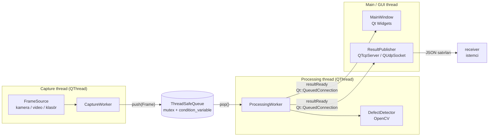

# Defect Inspector

Qt 6 + OpenCV ile yazılmış, Linux üzerinde çalışan **kamera izleme ve kusur tespit** uygulaması (C++17).
Kameradan, video dosyasından ya da bir görüntü klasöründen kare alır; kareleri ayrı bir thread'de
işleyip kumaş yüzeyindeki leke/yırtık benzeri kusurları bulur, sonucu arayüzde gösterir ve
TCP/UDP üzerinden başka bir istemciye gönderir.

> 🚧 Geliştirme aşamasında. Durum için [Yol haritası](#yol-haritası) bölümüne bakın.

## Mimari



**Neden bu yapı?**

- **Capture ↔ Processing arasında sınırlı bir kuyruk:** Görüntü işleme kameradan yavaş kalırsa
  kareler Qt olay kuyruğunda sınırsızca birikip bellek ve gecikme şişirmesin diye. Kuyruk doluyken
  en eski kare atılır (drop-oldest) — canlı izlemede güncellik, eksiksizlikten önemlidir.
- **Processing → GUI arasında signal/slot (`Qt::QueuedConnection`):** Qt widget'larına yalnızca
  ana thread'den dokunulabilir. Queued bağlantı, sonucu ana thread'in olay döngüsüne güvenle taşır.
- **`core` kütüphanesi Qt'den bağımsız:** Kuyruk ve dedektör saf C++/OpenCV'dir; GUI olmadan
  GoogleTest ile test edilebilir ve başka bir uygulamada (ör. Jetson üzerinde konsol servis) yeniden kullanılabilir.

## Klasör yapısı

```
defect-inspector/
├── CMakeLists.txt          # kök CMake projesi
├── cmake/                  # yardımcı CMake modülleri (uyarılar vb.)
├── src/
│   ├── core/               # Qt'siz çekirdek: ThreadSafeQueue, DefectDetector, DetectionResult
│   ├── app/                # Qt Widgets uygulaması: MainWindow, worker'lar, ResultPublisher
│   └── receiver/           # sonuçları dinleyen basit istemci
├── tests/                  # GoogleTest birim testleri
├── samples/                # örnek kumaş görüntüleri / videoları
├── scripts/                # ortam kurulum betikleri
└── docs/                   # ekran görüntüleri, ek dokümanlar
```

## Kurulum (Ubuntu 24.04 / WSL2)

```bash
bash scripts/setup_ubuntu.sh
```

Kurulan paketler: `build-essential gdb cmake ninja-build qt6-base-dev libopencv-dev libgtest-dev valgrind`.

## Derleme ve test

```bash
cmake -S . -B build -G Ninja
cmake --build build
ctest --test-dir build --output-on-failure
```

Data race avı için ThreadSanitizer ile:

```bash
cmake -S . -B build-tsan -G Ninja -DINSPECTOR_SANITIZER=thread
cmake --build build-tsan && ctest --test-dir build-tsan --output-on-failure
```

## Yol haritası

- [x] Proje iskeleti, CMake, GoogleTest
- [x] `ThreadSafeQueue` (producer–consumer) + testler
- [x] `DefectDetector` (gri ton → blur → yerel arka plan farkı → eşikleme → kontur) + testler
- [x] `FrameSource` soyutlaması: kamera / video / görüntü klasörü + fabrika fonksiyonu
- [ ] Capture ve processing thread'leri
- [ ] Qt Widgets arayüzü (canlı görüntü, start/stop, eşik, log)
- [ ] TCP/UDP ile sonuç yayını + receiver istemcisi
- [ ] Ekran görüntüleri, sınırlamalar, CI

## Sınırlamalar

- WSL2 varsayılan olarak USB kameralara erişemez; WSL'de video dosyası veya görüntü klasörü
  modu kullanılmalıdır.
- Dedektör klasik görüntü işlemeye dayanır: düzgün/tekdüze yüzeylerde iyi çalışır, ancak
  belirgin desenli (ekose, baskılı) kumaşlarda desenin kendisini kusur sanabilir. Bu durumlar
  için referans görüntüyle karşılaştırma ya da öğrenen bir model (CNN) gerekir.
- Arka plan penceresinden (`backgroundKernelSize`, varsayılan 101 px) büyük kusurlar
  arka plan tahminini bozar ve kısmen kaçırılabilir.
- _(Proje ilerledikçe güncellenecek.)_
