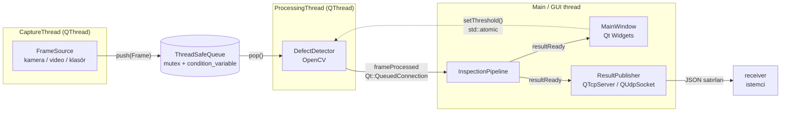

# Defect Inspector

[](https://github.com/mervanAksu/QT-Defect-Inspector/actions/workflows/ci.yml)

Qt 6 + OpenCV ile yazılmış, Linux üzerinde çalışan **kamera izleme ve kusur tespit** uygulaması (C++17).
Kameradan, video dosyasından ya da bir görüntü klasöründen kare alır; kareleri ayrı bir thread'de
işleyip kumaş yüzeyindeki leke/yırtık benzeri kusurları bulur, sonucu arayüzde gösterir ve
TCP/UDP üzerinden başka bir istemciye gönderir.

> 🚧 Geliştirme aşamasında. Durum için [Yol haritası](#yol-haritası) bölümüne bakın.


*Sentetik kumaş örnekleri üzerinde canlı tespit: kusurlar kırmızı kutuyla işaretlenir, sağda eşik
ayarı ve istatistikler, altta kusurlu karelerin logu.*

## Mimari



**Neden bu yapı?**

- **Capture ↔ Processing arasında sınırlı bir kuyruk:** Görüntü işleme kameradan yavaş kalırsa
  kareler Qt olay kuyruğunda sınırsızca birikip bellek ve gecikme şişirmesin diye. Kuyruk doluyken
  en eski kare atılır (drop-oldest) — canlı izlemede güncellik, eksiksizlikten önemlidir.
- **Processing → GUI arasında signal/slot (`Qt::QueuedConnection`):** Qt widget'larına yalnızca
  ana thread'den dokunulabilir. Queued bağlantı, sonucu ana thread'in olay döngüsüne güvenle taşır.
- **GUI → Processing yönünde `std::atomic<int>` eşik:** Tek bir tamsayı için kilit gereksiz.
  `DefectDetector` nesnesi yalnızca processing thread'inde yaşar, hiç paylaşılmaz.
- **Temiz kapanış:** `stop()` thread'lere kesme isteği gönderir, kuyruğu kapatarak `pop()`'ta
  bekleyeni uyandırır ve `wait()` ile bitmelerini bekler. Kaynak kendiliğinden biterse üretici
  kuyruğu kapatır, tüketici kalan kareleri işleyip çıkar.
- **`core` kütüphanesi Qt'den bağımsız:** Kuyruk ve dedektör saf C++/OpenCV'dir; GUI olmadan
  GoogleTest ile test edilebilir ve başka bir uygulamada (ör. Jetson üzerinde konsol servis) yeniden kullanılabilir.

## Klasör yapısı

```
defect-inspector/
├── CMakeLists.txt          # kök CMake projesi
├── cmake/                  # yardımcı CMake modülleri (uyarılar vb.)
├── src/
│   ├── core/               # Qt'siz çekirdek: ThreadSafeQueue, DefectDetector, FrameSource
│   ├── pipeline/           # Qt Core: CaptureThread, ProcessingThread, InspectionPipeline
│   ├── net/                # Qt Network: JSON Lines protokolü, LineBuffer, ResultPublisher
│   ├── app/                # Qt Widgets uygulaması: MainWindow, ImageView, main.cpp
│   └── receiver/           # C++ konsol istemcisi: ReceiverClient, defect_receiver
├── python/                 # Python alıcı istemcisi (yalnızca standart kütüphane) + testleri
├── tools/                  # sentetik kumaş görüntüsü üreteci (generate_samples)
├── tests/                  # GoogleTest birim testleri + Qt Test entegrasyon/GUI testleri
├── samples/fabric/         # 12 örnek kumaş görüntüsü + labels.csv (beklenen kusur sayıları)
├── scripts/                # ortam kurulum betikleri
└── docs/                   # ekran görüntüleri
```

## Kurulum (Ubuntu 24.04 / WSL2)

```bash
bash scripts/setup_ubuntu.sh
```

Kurulan paketler: `build-essential gdb cmake ninja-build qt6-base-dev libopencv-dev libgtest-dev valgrind`.

## Derleme ve test

```bash
cmake -S . -B build -G Ninja
cmake --build build
ctest --test-dir build --output-on-failure
```

GUI testleri ekran gerektirmez; ctest onları `QT_QPA_PLATFORM=offscreen` ile çalıştırır.

## Çalıştırma

```bash
./build/src/app/defect_inspector                         # örnek kumaş klasörü önceden seçili gelir
./build/src/app/defect_inspector samples/fabric --start  # hemen başlat
./build/src/app/defect_inspector video.mp4 -t 45         # video dosyası, eşik 45
./build/src/app/defect_inspector 0                       # kamera /dev/video0 (WSL2'de yok)
```

WSL2'de (Windows 11) pencere WSLg sayesinde doğrudan Windows masaüstünde açılır.

Örnek görüntüleri yeniden üretmek ve README ekran görüntüsünü güncellemek için:

```bash
./build/tools/generate_samples samples/fabric
QT_QPA_PLATFORM=offscreen ./build/src/app/defect_inspector --screenshot docs/screenshot.png
```

## Sağlamlık

Üretim hattında uygulamanın, operatör müdahalesi olmadan çalışmaya devam etmesi gerekir:

- **Kopan kamera:** Canlı bir kaynak kare vermeyi keserse (kablo çıktı, GigE kamera yeniden
  başladı) akış durmaz. Capture thread'i kaynağı üstel geri çekilmeyle (250 ms → … → 4 s)
  yeniden açmayı dener; log'da turuncu "Source lost" ve yeşil "Source recovered after N attempt(s)"
  görünür. Bekleme sırasında Stop'a basılırsa ~20 ms içinde durur (bekleme dilimlere bölünmüştür).
- **Bozuk görüntü dosyası:** Klasördeki okunamayan bir dosya atlanır ve sayılır; akış devam eder.
  Klasördeki tüm dosyalar bozuksa sonsuz döngüye girmeden biter.
- **Ayarların kaydı (`QSettings`):** Kaynak, döngü, eşik, TCP/UDP ayarları, pencere boyutu ve
  ayraç konumu kapanışta kaydedilir (`~/.config/DefectInspector/Defect Inspector.conf`) ve
  açılışta geri yüklenir. TCP sunucusu açık kaydedildiyse açılışta kendiliğinden dinlemeye başlar.
  Öncelik: komut satırı > kayıtlı ayar > varsayılan.
- **Test edilebilirlik:** `InspectionPipeline::start(std::unique_ptr<FrameSource>)` hazır bir
  kaynak kabul eder. Testler bununla gerçek kamera olmadan "5 kare sonra kopan, 3. denemede geri
  gelen" sahte bir kamerayı enjekte eder.

## Ağ üzerinden sonuç yayını (TCP / UDP)

Her işlenen kare için tek satırlık bir JSON mesajı yayınlanır (**JSON Lines**). Arayüzdeki
"Network" bölümünden ya da komut satırından açılır:

```bash
./build/src/app/defect_inspector samples/fabric --start --tcp 5555 --udp 127.0.0.1:5556
nc localhost 5555          # başka bir terminalde: canlı JSON satırları akar
```

```json
{"type":"inspection","version":1,"frame":3,"sent_at":"2026-11-26T15:29:16.055Z",
 "defect_count":1,"processing_ms":1.816,"latency_ms":2.094,"dropped_frames":0,
 "image":{"width":640,"height":480},
 "defects":[{"x":556,"y":127,"width":35,"height":48,"cx":572.76,"cy":150.31,"area":135}]}
```

*(Gerçekte her mesaj tek satırdır; burada okunabilirlik için bölündü.)*

| | TCP sunucusu | UDP |
|---|---|---|
| Model | Bağlanan her istemciye gönderilir | Tek bir hedef adrese (ya da broadcast) |
| Garanti | Güvenilir, sıralı | Kayıp olabilir, sıra garanti değil |
| Çerçeveleme | `\n` ile (TCP bir bayt akışıdır, mesaj sınırı yoktur) | Her datagram = bir mesaj |
| Ne zaman? | Kayıt/raporlama, her sonuç önemli | Canlı gösterge, en güncel değer önemli |

Tasarım notları:

- **Çerçeveleme:** Bir `read()` yarım mesaj ya da birden fazla mesaj getirebilir. `LineBuffer`
  parçaları biriktirip yalnızca tamamlanmış satırları verir. 64 KiB'tan uzun satırları atar (bellek koruması).
- **Yavaş istemci:** Okumayan bir istemcinin bekleyen verisi 1 MiB'ı aşarsa ona giden
  mesajlar atlanır. Böylece tek bir istemci sunucunun belleğini şişiremez.
- **Thread:** Qt soketleri asenkron (`write()` bloklamaz), bu yüzden yayıncı GUI thread'inde çalışır.
- **Sürümleme:** Mesajlarda `version` alanı var. Alıcılar bilmedikleri sürümü reddeder.

### Alıcı istemciler

Aynı çıktıyı üreten iki istemci var: biri C++/Qt, diğeri yalnızca standart kütüphaneyi
kullanan Python (`pip install` gerekmez; ör. hat yanındaki bir Raspberry Pi'de çalışabilir).

```bash
./build/src/receiver/defect_receiver --port 5555 --only-defects
python3 python/receiver.py --port 5555 --csv defects.csv
python3 python/receiver.py --udp 5556
```

```text
connecting to 127.0.0.1:5555
error: Connection refused
reconnecting in 1 s
error: Connection refused
reconnecting in 2 s
connected
#8      2 defect(s)  largest 107 px² @ (50,68)  latency 2.0 ms
#9      3 defect(s)  largest 567 px² @ (313,155)  latency 1.6 ms
#10     OK  latency 1.9 ms
```

- **Otomatik yeniden bağlanma:** Sunucu yoksa ya da bağlantı koparsa bekleme süresi her denemede
  ikiye katlanır (1 → 2 → 4 … en fazla 30 s), başarılı bağlantıda başa döner. Sabit aralıkla
  deneyen yüzlerce istemci, yeniden açılan sunucuyu aynı anda boğabilir ("thundering herd").
- **Hatalı mesaj bağlantıyı kesmez:** Çözülemeyen satırlar sayılır ve raporlanır, akış devam eder.
- **Ctrl+C:** Her iki istemci de düzgün çıkar ve özet basar. C++'ta sinyal işleyicisi yalnızca
  bir bayrak kaldırır (async-signal-safe), çıkışı olay döngüsü yapar.
- `--count N` ile N mesaj sonra çıkılır (betikler/testler için). Python istemcisi `--csv` ile
  her mesajı bir dosyaya da kaydeder.

### ThreadSanitizer ile data race avı

```bash
cmake -S . -B build-tsan -G Ninja -DINSPECTOR_SANITIZER=thread
setarch -R cmake --build build-tsan
TSAN_OPTIONS="suppressions=$PWD/tsan.supp" setarch -R ./build-tsan/tests/core_tests
```

Notlar:

- **`setarch -R`**: Yeni Linux çekirdeklerinde (WSL2 dahil) adres rastgeleleştirmesi (ASLR)
  GCC 13'ün TSan'ı ile uyumsuz ve program `unexpected memory mapping` hatasıyla açılmaz.
  `setarch -R` ASLR'yi yalnızca o komut için kapatır; root gerekmez.
- **`tsan.supp`**: TSan, kendisiyle derlenmemiş kütüphanelerin iç senkronizasyonunu göremez.
  Dosya yalnızca bu üçüncü parti kütüphaneleri (OpenCV'nin kullandığı TBB ve GDAL) susturur.
  Bununla `core_tests` (kuyruk testleri dahil 28 test) **sıfır uyarıyla** geçer.
- **`pipeline_tests` TSan ile anlamlı değil:** Ubuntu'nun Qt paketi TSan ile derlenmemiştir.
  `QThread::wait()` gibi Qt içindeki senkronizasyonu göremediği için TSan, thread bittikten
  sonra yapılan temizliği bile yarış sanır. Bunun için Qt'yi `-sanitize thread` ile derlemek gerekir.

### AddressSanitizer + UndefinedBehaviorSanitizer

Bellek hataları (taşma, use-after-free), sızıntılar ve tanımsız davranış için **tüm** testler:

```bash
cmake -S . -B build-asan -G Ninja -DINSPECTOR_SANITIZER=address,undefined \
      -DCMAKE_CXX_FLAGS=-fno-sanitize-recover=all
cmake --build build-asan
LSAN_OPTIONS="suppressions=$PWD/lsan.supp" ctest --test-dir build-asan --output-on-failure
```

ASan'ın bulduğu sızıntılar kodda iki iyileştirmeye yol açtı:

- **Video dosyası açma:** Açılamayan bir dosya için OpenCV tüm arka uçları sırayla deniyordu
  (GStreamer, gphoto2…). Bu yavaştı (~1 sn), konsola uyarı basıyordu ve o kütüphaneler bellek
  sızdırıyordu. Artık önce dosyanın varlığı kontrol ediliyor, sonra yalnızca FFmpeg kullanılıyor.
- **Proxy:** Qt soketleri varsayılanda sistemin HTTP proxy ayarını sorar. Yayıncı ve alıcı artık
  `QNetworkProxy::NoProxy` kullanıyor: yerel ağdaki doğrudan bağlantı masaüstü ayarlarından etkilenmez.

`lsan.supp` yalnızca testlerdeki düz `QTcpSocket` istemcilerinin tetiklediği libproxy'nin tek
seferlik ayırmasını susturur.

## Sürekli entegrasyon (GitHub Actions)

[`.github/workflows/ci.yml`](.github/workflows/ci.yml) her push (main) ve pull request'te,
geliştirme ortamıyla aynı dağıtımda (Ubuntu 24.04) üç iş çalıştırır:

| İş | Ne yapar? |
|---|---|
| **Build & test** | Release derleme, tüm uyarılar hata (`-Werror`), tüm testler (C++ + Python) |
| **AddressSanitizer + UBSan** | Tüm testler bellek hatası, sızıntı ve tanımsız davranış için |
| **ThreadSanitizer** | `core_tests`: kuyruk ve thread'li kod data race için |

## Yol haritası

- [x] Proje iskeleti, CMake, GoogleTest
- [x] `ThreadSafeQueue` (producer–consumer) + testler
- [x] `DefectDetector` (gri ton → blur → yerel arka plan farkı → eşikleme → kontur) + testler
- [x] `FrameSource` soyutlaması: kamera / video / görüntü klasörü + fabrika fonksiyonu
- [x] Capture ve processing thread'leri (`QThread`, queued signal/slot, atomik eşik) + Qt Test testleri
- [x] Qt Widgets arayüzü (canlı görüntü, start/stop, eşik, istatistikler, log) + GUI testleri
- [x] Sentetik kumaş örnekleri + uçtan uca tespit testleri
- [x] TCP/UDP ile sonuç yayını (JSON Lines, `QTcpServer` / `QUdpSocket`) + ağ testleri
- [x] Alıcı istemciler (C++/Qt ve Python), otomatik yeniden bağlanma + testleri
- [x] GitHub Actions CI: `-Werror` derleme, ASan + UBSan, ThreadSanitizer
- [x] Sağlamlık: kopan kamerayı yeniden bağlama, bozuk dosyaları atlama, `QSettings`
- [ ] Sınırlamalar ve son README

## Sınırlamalar

- WSL2 varsayılan olarak USB kameralara erişemez; WSL'de video dosyası veya görüntü klasörü
  modu kullanılmalıdır. Kamera kopması ve yeniden bağlanma bu yüzden gerçek donanımla değil,
  sahte bir kamera kaynağıyla (testlerde) doğrulandı.
- Dedektör klasik görüntü işlemeye dayanır: düzgün/tekdüze yüzeylerde iyi çalışır, ancak
  belirgin desenli (ekose, baskılı) kumaşlarda desenin kendisini kusur sanabilir. Bu durumlar
  için referans görüntüyle karşılaştırma ya da öğrenen bir model (CNN) gerekir.
- Arka plan penceresinden (`backgroundKernelSize`, varsayılan 101 px) büyük kusurlar
  arka plan tahminini bozar ve kısmen kaçırılabilir.
- _(Proje ilerledikçe güncellenecek.)_
