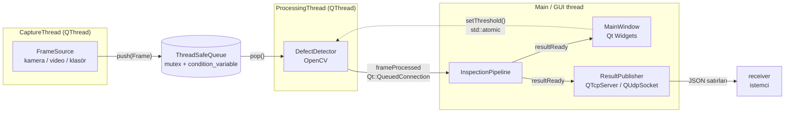

# Defect Inspector

Qt 6 + OpenCV ile yazılmış, Linux üzerinde çalışan **kamera izleme ve kusur tespit** uygulaması (C++17).
Kameradan, video dosyasından ya da bir görüntü klasöründen kare alır; kareleri ayrı bir thread'de
işleyip kumaş yüzeyindeki leke/yırtık benzeri kusurları bulur, sonucu arayüzde gösterir ve
TCP/UDP üzerinden başka bir istemciye gönderir.

> 🚧 Geliştirme aşamasında. Durum için [Yol haritası](#yol-haritası) bölümüne bakın.


*Sentetik kumaş örnekleri üzerinde canlı tespit: kusurlar kırmızı kutuyla işaretlenir, sağda eşik
ayarı ve istatistikler, altta kusurlu karelerin logu.*

## Mimari



**Neden bu yapı?**

- **Capture ↔ Processing arasında sınırlı bir kuyruk:** Görüntü işleme kameradan yavaş kalırsa
  kareler Qt olay kuyruğunda sınırsızca birikip bellek ve gecikme şişirmesin diye. Kuyruk doluyken
  en eski kare atılır (drop-oldest) — canlı izlemede güncellik, eksiksizlikten önemlidir.
- **Processing → GUI arasında signal/slot (`Qt::QueuedConnection`):** Qt widget'larına yalnızca
  ana thread'den dokunulabilir. Queued bağlantı, sonucu ana thread'in olay döngüsüne güvenle taşır.
- **GUI → Processing yönünde `std::atomic<int>` eşik:** Tek bir tamsayı için kilit gereksiz.
  `DefectDetector` nesnesi yalnızca processing thread'inde yaşar, hiç paylaşılmaz.
- **Temiz kapanış:** `stop()` thread'lere kesme isteği gönderir, kuyruğu kapatarak `pop()`'ta
  bekleyeni uyandırır ve `wait()` ile bitmelerini bekler. Kaynak kendiliğinden biterse üretici
  kuyruğu kapatır, tüketici kalan kareleri işleyip çıkar.
- **`core` kütüphanesi Qt'den bağımsız:** Kuyruk ve dedektör saf C++/OpenCV'dir; GUI olmadan
  GoogleTest ile test edilebilir ve başka bir uygulamada (ör. Jetson üzerinde konsol servis) yeniden kullanılabilir.

## Klasör yapısı

```
defect-inspector/
├── CMakeLists.txt          # kök CMake projesi
├── cmake/                  # yardımcı CMake modülleri (uyarılar vb.)
├── src/
│   ├── core/               # Qt'siz çekirdek: ThreadSafeQueue, DefectDetector, FrameSource
│   ├── pipeline/           # Qt Core: CaptureThread, ProcessingThread, InspectionPipeline
│   ├── app/                # Qt Widgets uygulaması: MainWindow, ImageView, main.cpp
│   └── receiver/           # sonuçları dinleyen basit istemci
├── tools/                  # sentetik kumaş görüntüsü üreteci (generate_samples)
├── tests/                  # GoogleTest birim testleri + Qt Test entegrasyon/GUI testleri
├── samples/fabric/         # 12 örnek kumaş görüntüsü + labels.csv (beklenen kusur sayıları)
├── scripts/                # ortam kurulum betikleri
└── docs/                   # ekran görüntüleri
```

## Kurulum (Ubuntu 24.04 / WSL2)

```bash
bash scripts/setup_ubuntu.sh
```

Kurulan paketler: `build-essential gdb cmake ninja-build qt6-base-dev libopencv-dev libgtest-dev valgrind`.

## Derleme ve test

```bash
cmake -S . -B build -G Ninja
cmake --build build
ctest --test-dir build --output-on-failure
```

GUI testleri ekran gerektirmez; ctest onları `QT_QPA_PLATFORM=offscreen` ile çalıştırır.

## Çalıştırma

```bash
./build/src/app/defect_inspector                         # örnek kumaş klasörü önceden seçili gelir
./build/src/app/defect_inspector samples/fabric --start  # hemen başlat
./build/src/app/defect_inspector video.mp4 -t 45         # video dosyası, eşik 45
./build/src/app/defect_inspector 0                       # kamera /dev/video0 (WSL2'de yok)
```

WSL2'de (Windows 11) pencere WSLg sayesinde doğrudan Windows masaüstünde açılır.

Örnek görüntüleri yeniden üretmek ve README ekran görüntüsünü güncellemek için:

```bash
./build/tools/generate_samples samples/fabric
QT_QPA_PLATFORM=offscreen ./build/src/app/defect_inspector --screenshot docs/screenshot.png
```

### ThreadSanitizer ile data race avı

```bash
cmake -S . -B build-tsan -G Ninja -DINSPECTOR_SANITIZER=thread
setarch -R cmake --build build-tsan
TSAN_OPTIONS="suppressions=$PWD/tsan.supp" setarch -R ./build-tsan/tests/core_tests
```

Notlar:

- **`setarch -R`**: Yeni Linux çekirdeklerinde (WSL2 dahil) adres rastgeleleştirmesi (ASLR)
  GCC 13'ün TSan'ı ile uyumsuz ve program `unexpected memory mapping` hatasıyla açılmaz.
  `setarch -R` ASLR'yi yalnızca o komut için kapatır; root gerekmez.
- **`tsan.supp`**: TSan, kendisiyle derlenmemiş kütüphanelerin iç senkronizasyonunu göremez.
  Dosya yalnızca bu üçüncü parti kütüphaneleri (OpenCV'nin kullandığı TBB ve GDAL) susturur.
  Bununla `core_tests` (kuyruk testleri dahil 28 test) **sıfır uyarıyla** geçer.
- **`pipeline_tests` TSan ile anlamlı değil:** Ubuntu'nun Qt paketi TSan ile derlenmemiştir.
  `QThread::wait()` gibi Qt içindeki senkronizasyonu göremediği için TSan, thread bittikten
  sonra yapılan temizliği bile yarış sanır. Bunun için Qt'yi `-sanitize thread` ile derlemek gerekir.

## Yol haritası

- [x] Proje iskeleti, CMake, GoogleTest
- [x] `ThreadSafeQueue` (producer–consumer) + testler
- [x] `DefectDetector` (gri ton → blur → yerel arka plan farkı → eşikleme → kontur) + testler
- [x] `FrameSource` soyutlaması: kamera / video / görüntü klasörü + fabrika fonksiyonu
- [x] Capture ve processing thread'leri (`QThread`, queued signal/slot, atomik eşik) + Qt Test testleri
- [x] Qt Widgets arayüzü (canlı görüntü, start/stop, eşik, istatistikler, log) + GUI testleri
- [x] Sentetik kumaş örnekleri + uçtan uca tespit testleri
- [ ] TCP/UDP ile sonuç yayını + receiver istemcisi
- [ ] Sınırlamalar, CI

## Sınırlamalar

- WSL2 varsayılan olarak USB kameralara erişemez; WSL'de video dosyası veya görüntü klasörü
  modu kullanılmalıdır.
- Dedektör klasik görüntü işlemeye dayanır: düzgün/tekdüze yüzeylerde iyi çalışır, ancak
  belirgin desenli (ekose, baskılı) kumaşlarda desenin kendisini kusur sanabilir. Bu durumlar
  için referans görüntüyle karşılaştırma ya da öğrenen bir model (CNN) gerekir.
- Arka plan penceresinden (`backgroundKernelSize`, varsayılan 101 px) büyük kusurlar
  arka plan tahminini bozar ve kısmen kaçırılabilir.
- _(Proje ilerledikçe güncellenecek.)_
